<p align="center">
  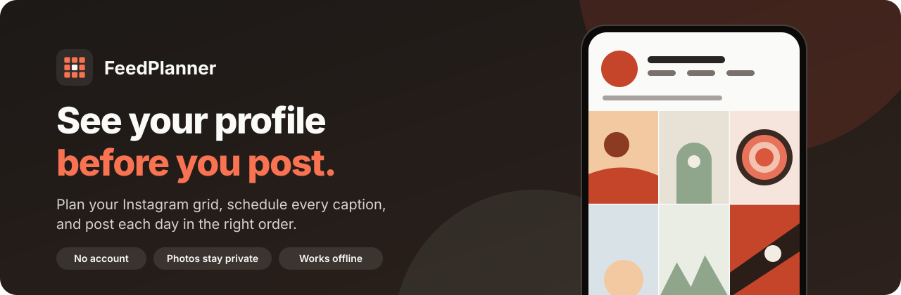
</p>

<p align="center">
  <strong>Plan your Instagram grid, schedule every caption, and post each day in the right order.</strong><br>
  No account, no uploads: your photos never leave your browser.
</p>

<p align="center">
  <a href="https://haseeb35.github.io/FeedPlanner-/">
    
  </a>
</p>

<p align="center">
  
  
  
  
  
  
</p>

---

## What it does

Instagram shows your newest post top-left, so a feed that looks good as a whole has to be planned and then posted in reverse order. FeedPlanner does that planning for you:

- **See it first:** drop in photos and preview your real profile (username, bio, highlights and grid) before anything goes live.
- **Plan the details:** captions, hashtags, dates, post types and crops for every tile.
- **Post on time:** each day the **Today** screen tells you what's next, and **Post now** walks you through publishing it.

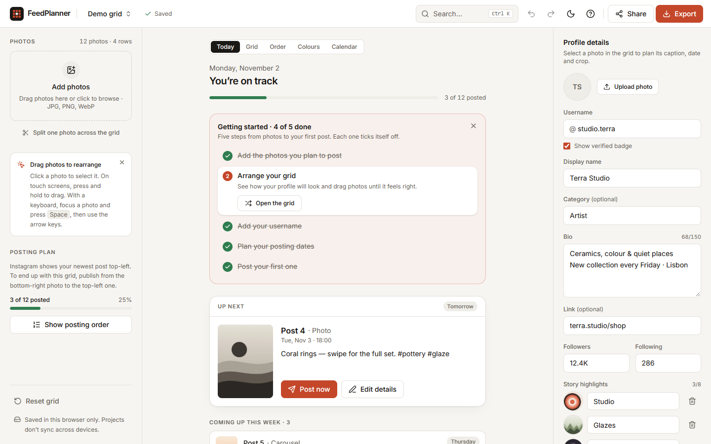

## How it works

<p align="center">
  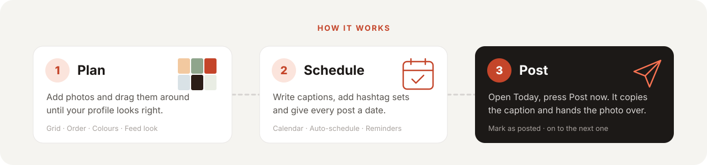
</p>

1. **Plan:** add photos (or try the demo), drag them around the grid, and check the colours flow.
2. **Schedule:** write captions, reuse saved hashtag sets, give each post a date or let **Auto-schedule** do it, then **Add to calendar** for reminders.
3. **Post:** open **Today**, press **Post now**, paste into Instagram, tick it off. FeedPlanner moves you on to the next post.

> FeedPlanner never posts to Instagram by itself. That needs Instagram's official API and a server. It gets everything ready so publishing takes seconds.

## Screenshots

| Plan your grid | Post now |
| --- | --- |
| 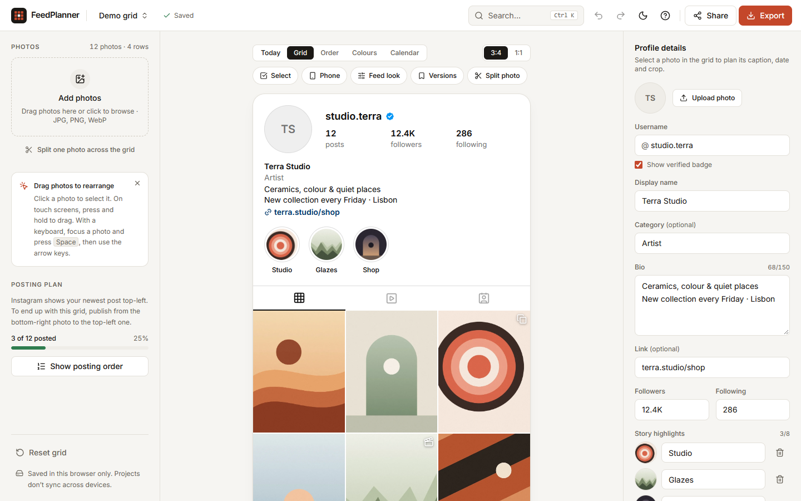 | 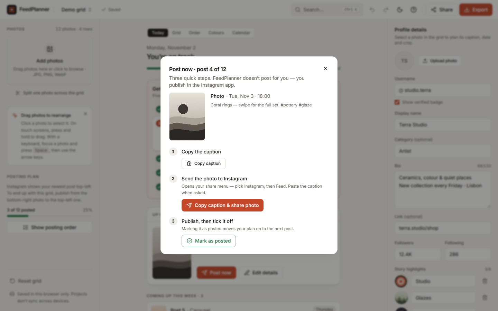 |
| **Post details** | **Calendar** |
| 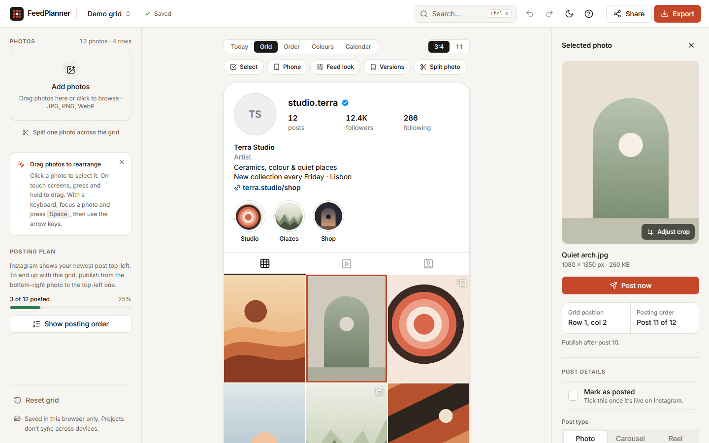 | 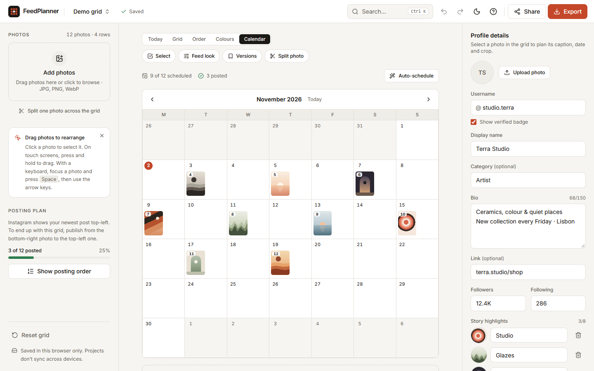 |
| **Quick search (Ctrl/⌘ + K)** | **Dark mode** |
| 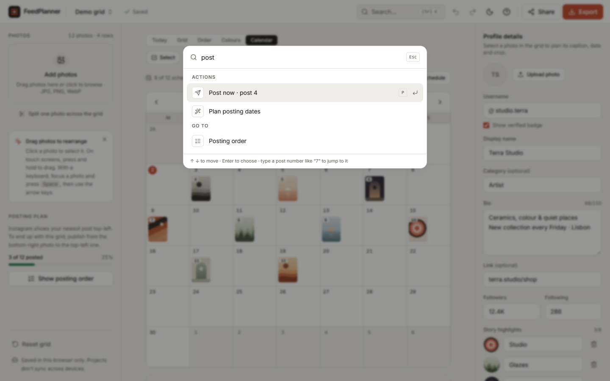 | 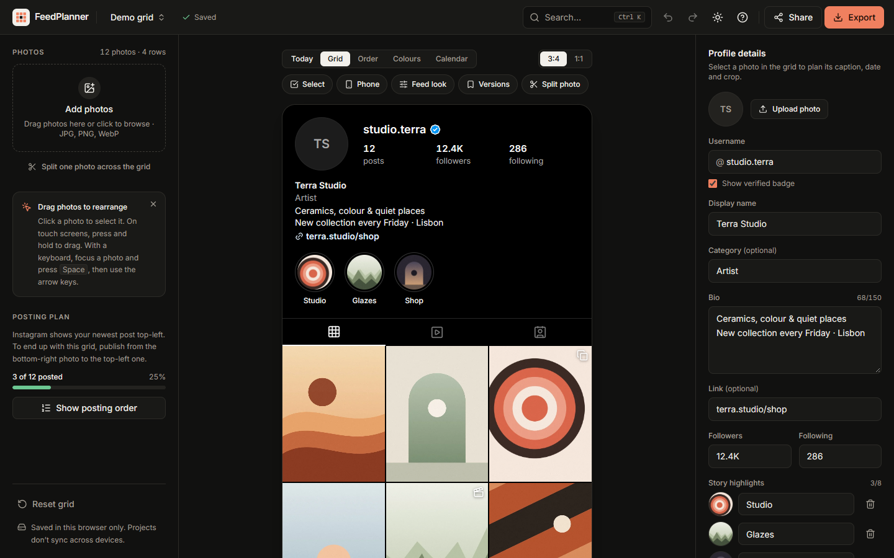 |

<p align="center">
  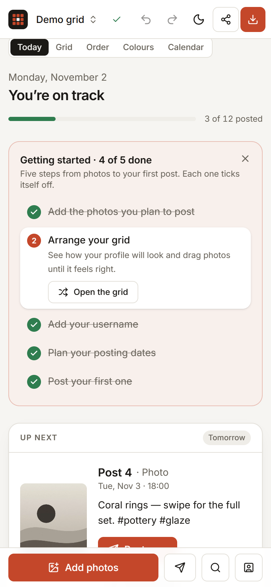
  &nbsp;&nbsp;
  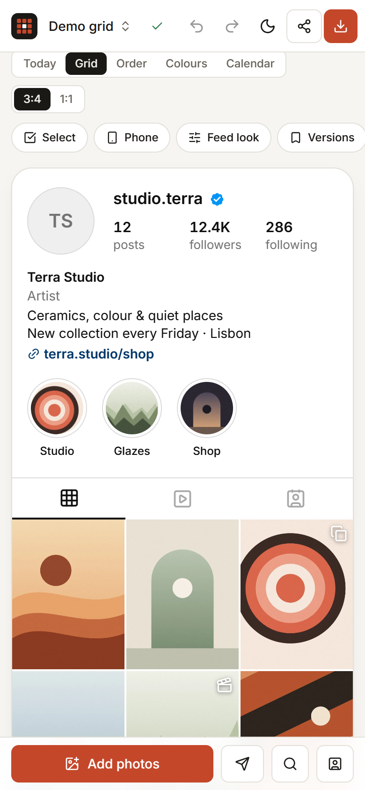
  <br><em>Works on phones too, with a bottom bar for Add photos, Post now, Search and Profile.</em>
</p>

## Features

### Every day
| | |
| --- | --- |
| 📅 **Today** | The screen FeedPlanner opens on: the next post to publish, what's overdue, due today and coming up this week, posts missing a caption or date, and overall progress. |
| 🚀 **Post now** | Three steps for one post: copy the caption, hand the original photo to Instagram through the share menu (or download it on computers), mark it as posted. Warns when a post would go up out of order. |
| ⏰ **Calendar reminders** | **Add to calendar** downloads an `.ics` file for Google, Apple or Outlook calendar. Each post gets a reminder (15 minutes before, or 9:00 for posts without a time), even when FeedPlanner is closed. |
| #️⃣ **Hashtag sets & snippets** | Save hashtag groups and caption lines once, add them to any caption with one click. Hashtags already in the caption are skipped; duplicates and the 30-hashtag limit are flagged. |
| 🔎 **Quick search** | `Ctrl/⌘ + K` finds any action, view, project, or post by caption or number. |

### Planning
| | |
| --- | --- |
| 🧩 **Grid planning** | Drag to reorder, undo/redo, 3:4 or 1:1 tiles, multi-select for bulk moves, and a numbered **posting order**. |
| 📝 **Post details** | Caption with character and hashtag counters, date and time, post type (photo, carousel, Reel) and a **Mark as posted** checklist. |
| 🗓️ **Calendar** | Month view. Drag posts between days, **Auto-schedule** in posting order, and get warned when dates would shuffle the grid. |
| ✂️ **Crop & split** | Pick each tile's focal point and zoom, or cut one image into a 3×1, 3×2 or 3×3 puzzle. |
| 🎨 **Colours & feed look** | Each photo's main colours, the feed's palette, look-alike neighbours, and one filter applied to every photo. |
| 🔖 **Versions** | Save named arrangements, compare and restore them. |
| 👤 **Profile preview** | Username, verified badge, category, bio, link, story highlights and an optional phone frame. |

### Sharing & safety
| | |
| --- | --- |
| 🖼️ **Export** | Grid or full profile as PNG or JPG, at 1080 or 2160 px. |
| 🤝 **Share with friends** | Send a preview image or the whole project through the share menu (WhatsApp, Mail, AirDrop…). Dropping a `.feedplanner` file onto the app opens it. |
| 💡 **Feed ideas** | Share the idea behind a feed as a link: layout, post types, colour hints and optional captions, no photos. It lives in the link's `#fragment`, which is never sent to a server. Six built-in ideas included. |
| 💾 **Backup & restore** | One `.feedplanner` file holds projects and original photos. Restoring always adds, never overwrites. |
| 📲 **Installable & offline** | Production builds register a service worker, so the app opens offline and can be installed. |

### New here?
New users get a **getting-started checklist** on Today that ticks itself off, and a short **spotlight tour** once their first photos are in. Both come back from **Help** (`?`).

## Privacy

FeedPlanner is local-first. Projects and photos are stored in your browser's IndexedDB. Nothing is uploaded, there are no accounts, no API keys and no tracking. Projects don't sync between browsers or devices; use **Backup** or **Share** to move them.

## Getting started

```bash
git clone https://github.com/Haseeb35/FeedPlanner-.git
cd FeedPlanner-
npm install
npm run dev        # http://localhost:5173
```

| Command             | What it does                         |
| ------------------- | ------------------------------------ |
| `npm run dev`       | Start the dev server                 |
| `npm run build`     | Type-check and build for production  |
| `npm run preview`   | Serve the production build           |
| `npm run typecheck` | TypeScript only                      |
| `npm run lint`      | ESLint                               |
| `npm test`          | Unit tests (Vitest)                  |

## How the grid order works

The grid shows your **final profile**: the top-left tile is your newest post. Instagram places each new post top-left, so to recreate the plan you publish from the bottom-right photo to the top-left one. Turn on **Posting order** to number every tile with the order to publish it in. The grid is never reversed behind your back.

## Keyboard

- `Ctrl/⌘ + Z` undo, `Ctrl/⌘ + Shift + Z` or `Ctrl + Y` redo, `Ctrl/⌘ + S` save now
- Focus a photo: `Enter` selects it, `Space` picks it up, arrow keys move it, `Space` drops it, `Esc` cancels
- `Delete` removes the selected photo (undoable)
- `Ctrl/⌘ + K` quick search, `?` help
- When you're not typing: `A` add photos, `P` post the next photo, `T` Today, `G` grid, `C` calendar

## Structure

```
src/
  lib/          framework-free logic
    grid.ts       ordering, posting numbers, undo/redo history
    db.ts         IndexedDB persistence (projects + image blobs)
    images.ts     validation, decoding, thumbnails
    export.ts     canvas renderer for grid / profile exports
    posts.ts      captions, schedule, conflicts, filters
    backup.ts     .feedplanner backup format (binary, no base64)
    colors.ts     palette and similarity analysis
    split.ts      puzzle split
    templates.ts  feed ideas: link encoding, project ↔ template, built-ins
    share.ts      Web Share with download fallback
    today.ts      daily agenda (next, overdue, upcoming, needs attention)
    calendar.ts   .ics export with reminders
    snippets.ts   hashtag sets and caption snippets (localStorage)
    demo.ts       procedurally drawn demo artwork
  hooks/        useProjectEditor (state + autosave), useObjectUrls, useMediaQuery
  providers/    theme, toasts, confirmation dialog
  components/   UI (Workspace, PhotoGrid, InstagramProfilePreview, ExportDialog, …)
```

Images are stored as native Blobs with a separate thumbnail. The grid renders thumbnails, and export redraws from the originals. Photos removed from a grid are kept until the project is next opened, so undo can bring them back. Photos used only by a saved version or a highlight cover are kept too.
